# Notas de corte do SISU/UFMG, 2014–2026: 20 análises

[](https://pypi.org/project/sisu-ufmg-notas-de-corte-dados/)

> **Só quer os dados?** Não precisa clonar este repositório: o dataset completo (sem scripts de coleta/análise, gráficos ou posts) está no pacote [`sisu-ufmg-notas-de-corte-dados`](https://pypi.org/project/sisu-ufmg-notas-de-corte-dados/):
>
> ```
> pip install sisu-ufmg-notas-de-corte-dados
> ```
>
> Este repositório é para quem quer o código e as 20 análises.

Análise de dados com as notas de corte da Universidade Federal de Minas Gerais no SISU, de 2014 a 2026. São 20 análises independentes, cada uma com pergunta, script, gráfico.

## Fonte dos dados

- **SISU/MEC e UFMG:** PDFs oficiais de "notas máximas e mínimas" de cada chamada, publicados no repositório do SISU/UFMG (`https://www.ufmg.br/sisu/repositorio/`).
- Os PDFs foram transcritos para CSV e depois limpos e validados (padronização de cursos, turnos e códigos de cota, conferência amostral contra os PDFs). O processo está em [`docs/qualidade_dados.md`](docs/qualidade_dados.md) e [`docs/relatorio_qualidade_base.md`](docs/relatorio_qualidade_base.md).
- A base é **agregada** por curso, campus, turno, chamada e cota. Não contém dados pessoais.

## Análises

### 01. [As maiores notas de corte da UFMG subiram, e Medicina segue isolada no topo](posts/01-evolucao-maiores-notas.md)

<a href="posts/01-evolucao-maiores-notas.md">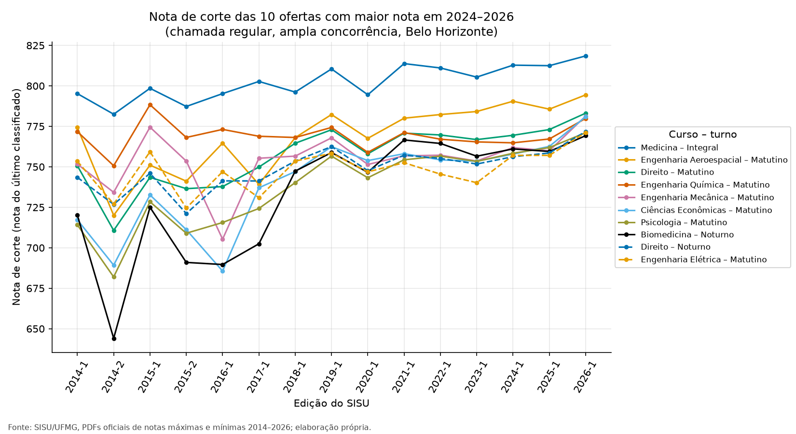</a>

### 02. [Medicina liderou todas as edições; só 3 ofertas ficaram sempre no top 10](posts/02-ranking-topo.md)

<a href="posts/02-ranking-topo.md">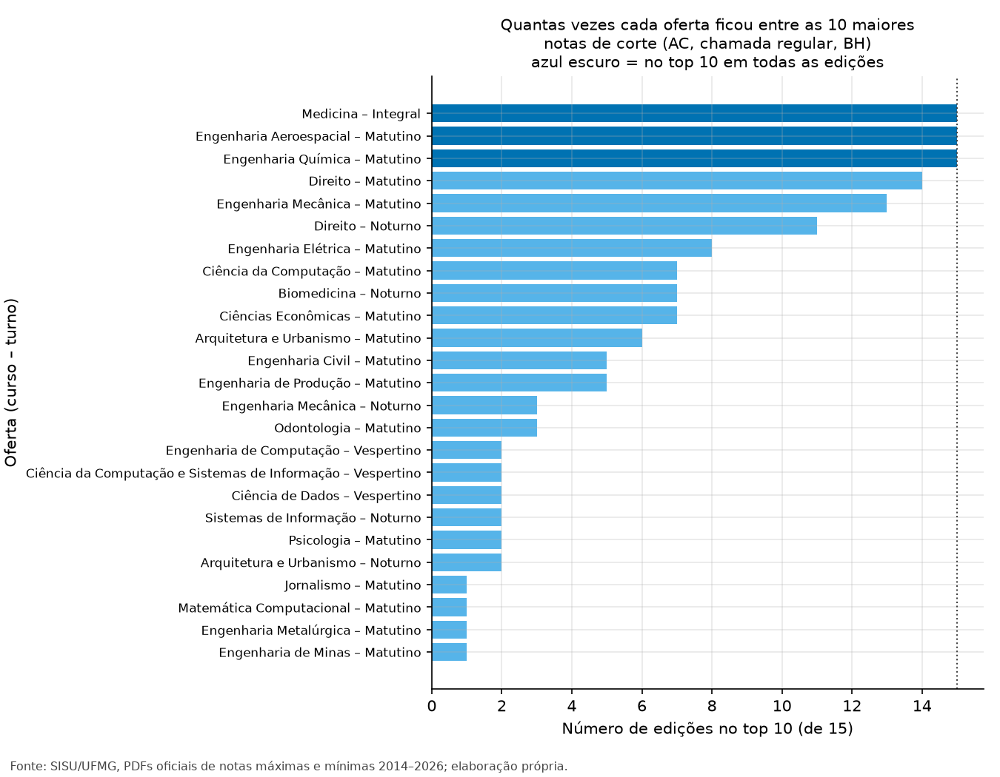</a>

### 03. [As menores notas de corte estão em cursos de nicho e em Montes Claros, e ficaram relativamente mais baixas](posts/03-cursos-acessiveis.md)

<a href="posts/03-cursos-acessiveis.md">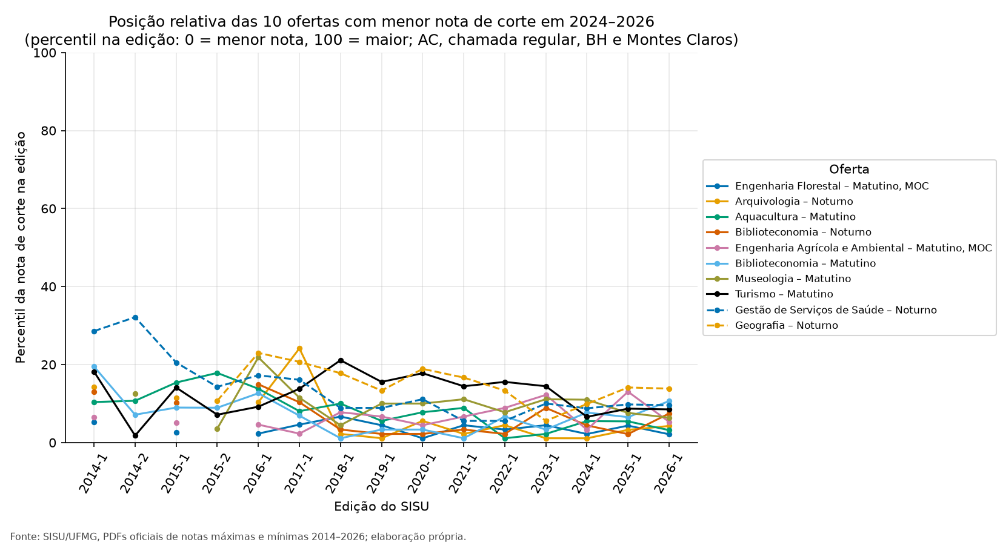</a>

### 04. [A lista de espera derruba a nota de corte, sobretudo nas cotas para pessoas pretas, pardas e indígenas](posts/04-queda-entre-chamadas.md)

<a href="posts/04-queda-entre-chamadas.md">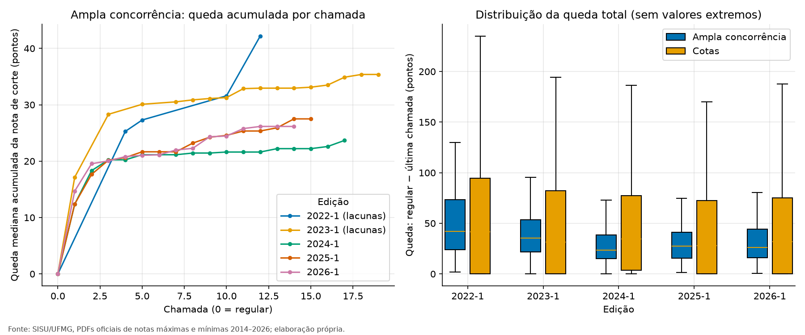</a>

### 05. [Ofertas com nota de corte mais alta têm turmas mais "apertadas"](posts/05-amplitude-por-curso.md)

<a href="posts/05-amplitude-por-curso.md">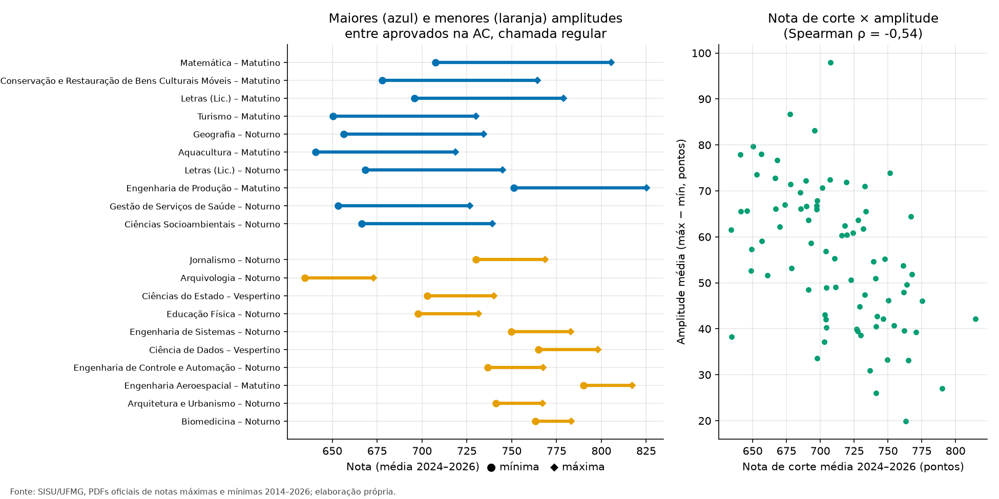</a>

### 06. [Belo Horizonte × Montes Claros: a diferença caiu muito a partir de 2018](posts/06-bh-x-montes-claros.md)

<a href="posts/06-bh-x-montes-claros.md">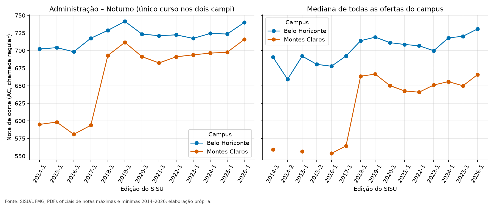</a>

### 07. [O noturno tem nota de corte menor que o turno diurno em 85% das comparações](posts/07-turnos.md)

<a href="posts/07-turnos.md">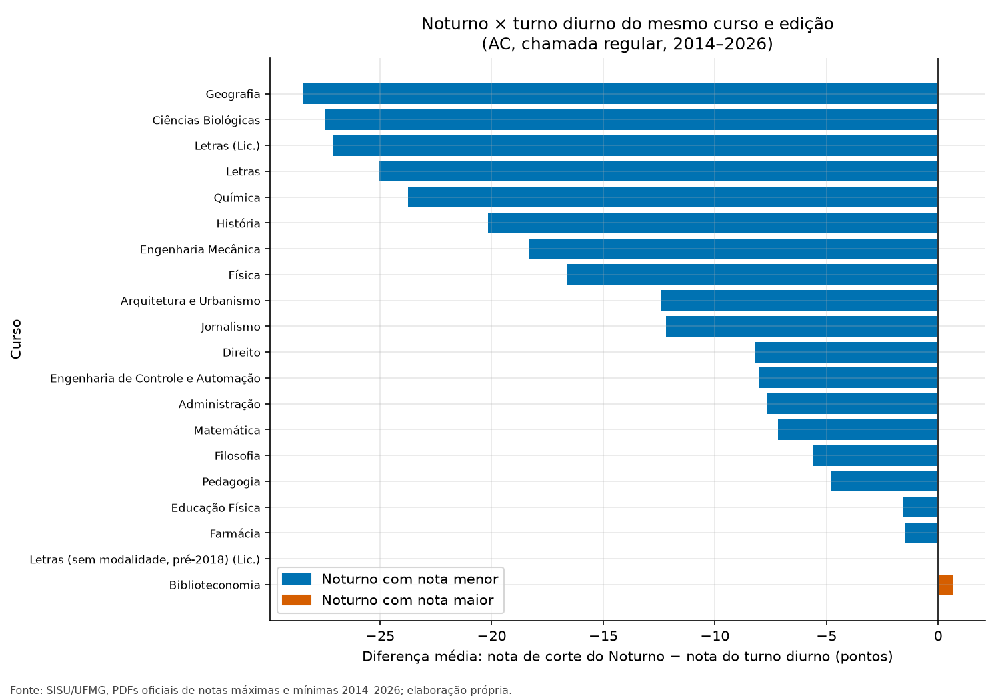</a>

### 08. [Onde dá para comparar, o bacharelado teve nota de corte maior que a licenciatura](posts/08-bacharelado-x-licenciatura.md)

<a href="posts/08-bacharelado-x-licenciatura.md">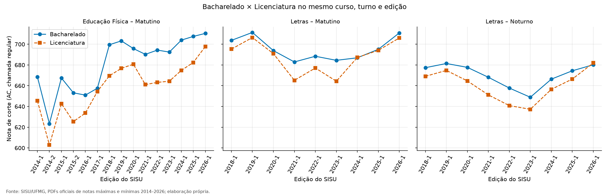</a>

### 09. [Em 2024–2026, nenhuma cota teve nota de corte acima da ampla concorrência, e a distância vai de 10 a 160 pontos](posts/09-ampla-concorrencia-x-cotas.md)

<a href="posts/09-ampla-concorrencia-x-cotas.md">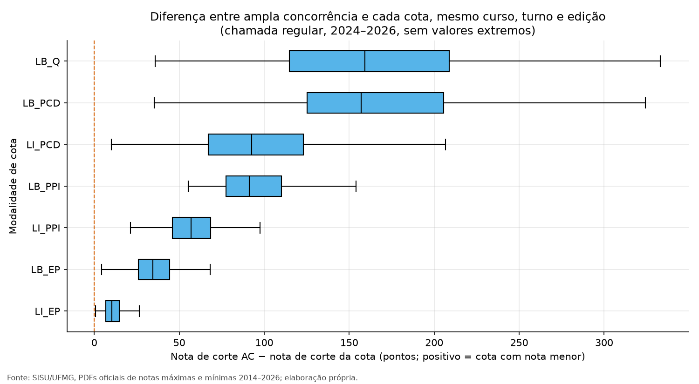</a>

### 10. [A distância entre ampla concorrência e escola pública subiu até 2016-1, caiu até 2020 e está estável desde então](posts/10-ampla-concorrencia-x-escola-publica.md)

<a href="posts/10-ampla-concorrencia-x-escola-publica.md">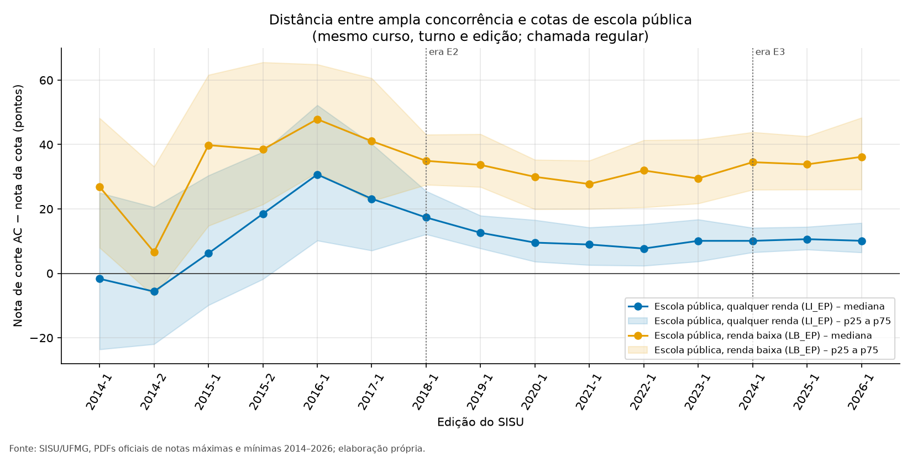</a>

### 11. [A cota PCD existe desde 2018 e tem as notas de corte mais dispersas da base](posts/11-cota-pcd.md)

<a href="posts/11-cota-pcd.md">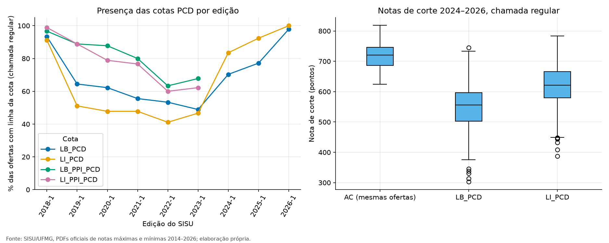</a>

### 12. [2024 trocou os códigos de cota: algumas séries continuam, outras quebram](posts/12-mudanca-de-regime-2024.md)

<a href="posts/12-mudanca-de-regime-2024.md">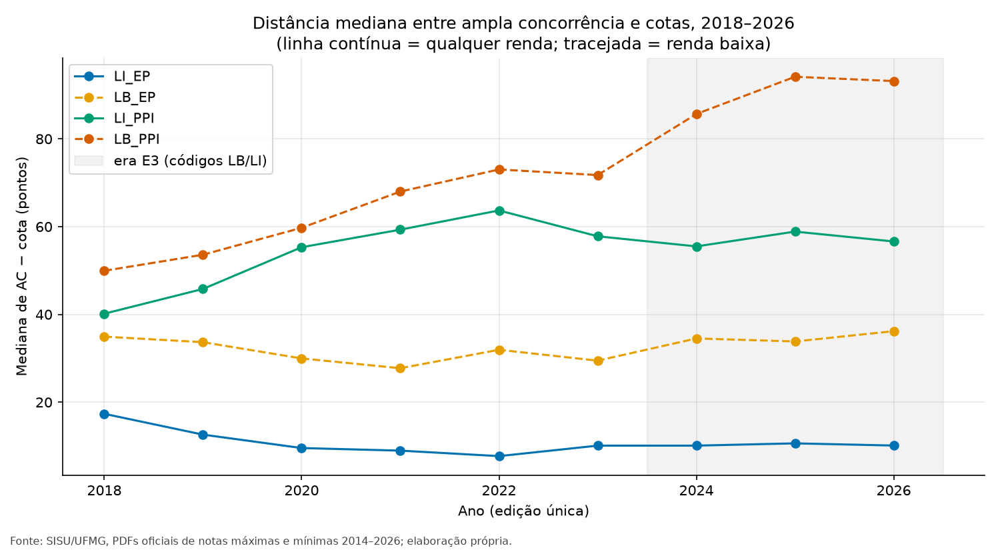</a>

### 13. [A oferta no SISU/UFMG passou de 77 para 94 ofertas, mas o salto de linhas vem das listas de espera](posts/13-expansao-da-oferta.md)

<a href="posts/13-expansao-da-oferta.md">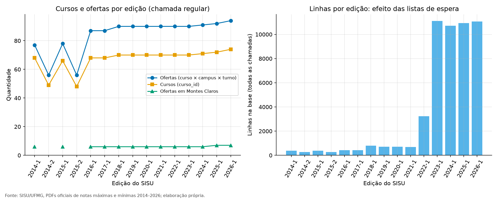</a>

### 14. [Mapa de calor: 84 ofertas de BH em 15 edições, numa só imagem](posts/14-mapa-de-calor.md)

<a href="posts/14-mapa-de-calor.md">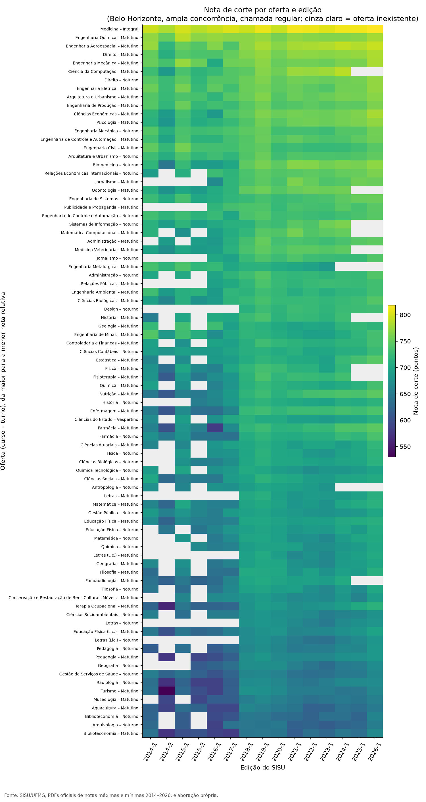</a>

### 15. [Agrupando as ofertas pelo perfil de nota: 4 grupos](posts/15-agrupamento-de-cursos.md)

<a href="posts/15-agrupamento-de-cursos.md">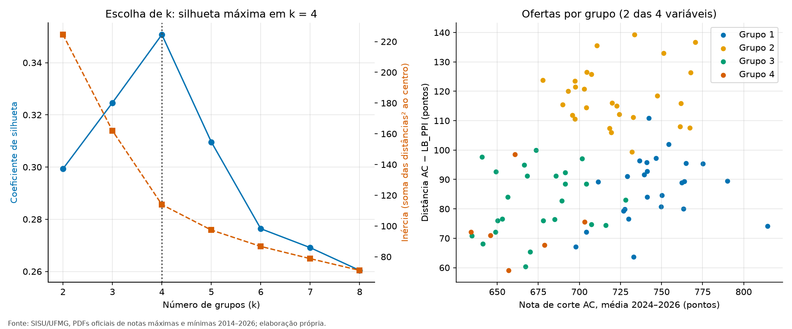</a>

### 16. [O ranking de notas de corte quase não muda de um ano para o outro (ρ entre 0,91 e 0,99)](posts/16-estabilidade-do-ranking.md)

<a href="posts/16-estabilidade-do-ranking.md">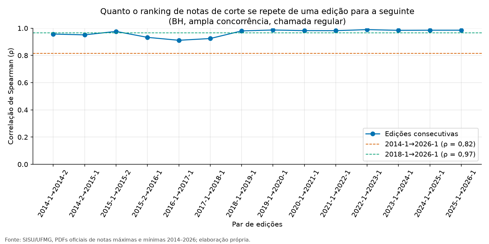</a>

### 17. [Projetar a nota de corte de 2027 com uma reta: um exercício com margem de erro de dezenas de pontos](posts/17-tendencia-e-projecao-2027.md)

<a href="posts/17-tendencia-e-projecao-2027.md">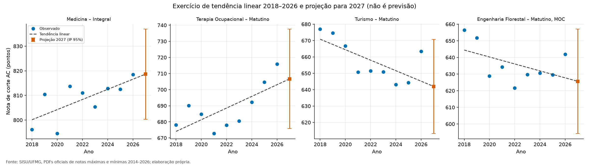</a>

### 18. [Ciências Exatas e Engenharias e Ciências da Saúde no topo, Ciências Biológicas e Agrárias embaixo, mas as áreas se sobrepõem muito](posts/18-areas-do-conhecimento.md)

<a href="posts/18-areas-do-conhecimento.md">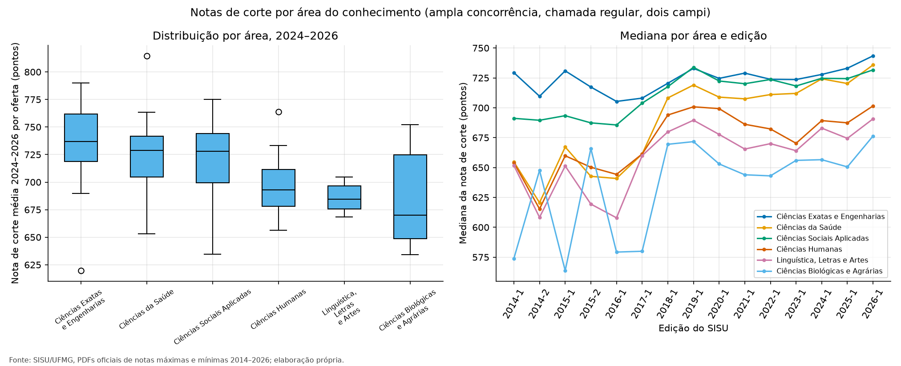</a>

### 19. [Entre 2018 e 2026, 69 de 79 ofertas subiram a nota de corte, e a maior alta foi de 37,7 pontos](posts/19-maiores-altas-e-quedas.md)

<a href="posts/19-maiores-altas-e-quedas.md">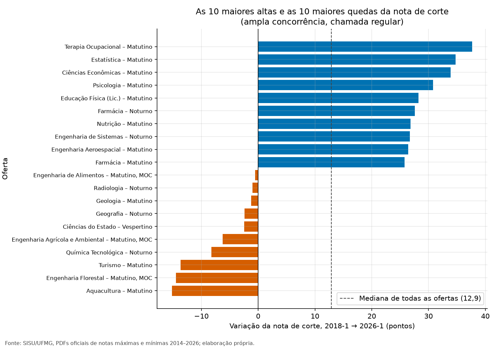</a>

### 20. [Antes de tudo: como esta base funciona e onde ela engana](posts/20-guia-uso-e-qualidade.md)

<a href="posts/20-guia-uso-e-qualidade.md">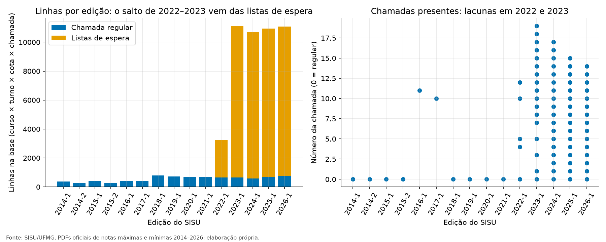</a>

## Ajustes em relação à lista original de análises

Todas as 20 análises foram feitas. Algumas foram reformuladas porque os dados pediam:

- **01, 02 e 03 – "mais concorridos":** a base não tem número de candidatos, então "mais concorrido" virou "maior nota de corte", e os posts dizem isso.
- **06 – BH × Montes Claros:** só **um** curso (Administração, Noturno) é oferecido nos dois campi. A análise mantém esse par e acrescenta a comparação das medianas de cada campus como contexto.
- **07 – Turnos:** Matutino, Vespertino e Integral nunca coexistem no mesmo curso e edição, e 7 cursos trocaram Matutino por Integral/Vespertino em 2025. A comparação possível é **Noturno × turno diurno**.
- **08 – Bacharelado × Licenciatura:** só três cursos têm as duas modalidades no mesmo turno e edição (Educação Física, Letras e Teatro).
- **14 – Mapa de calor:** feito por **oferta** (curso × turno), não só por curso, para não misturar notas de turnos diferentes.
- **19 – Altas e quedas:** só ampla concorrência, porque 2018 e 2026 estão em eras de cota diferentes.

## Estrutura

```
├── README.md
├── LICENSE                  # MIT
├── requirements.txt         # versões fixas
├── data/                    # CSVs limpos usados pelas análises
│   ├── notas_corte.csv          # base longa (52.144 linhas)
│   ├── notas_corte_final.csv    # última chamada de cada chave (8.405 linhas)
│   ├── de_para_cursos.csv       # nome bruto → curso_id
│   ├── de_para_cotas.csv        # código de cota por era → código padronizado + confiança
│   ├── areas_conhecimento.csv   # curso_id → área (criado para o post 18)
│   └── excecoes_monotonia.csv   # vazio: nenhuma nota mínima sobe entre chamadas
├── scripts/                 # 01_*.py … 20_*.py, comum.py, run_all.py
├── posts/                   # um Markdown por análise
├── figuras/                 # PNGs gerados pelos scripts
├── tests/                   # pytest: checagens de cada análise contra os CSVs
└── docs/
    ├── qualidade_dados.md         # validações e decisões de limpeza
    └── relatorio_qualidade_base.md  # relatório completo da construção da base
```

## Como instalar e rodar

Requer Python 3.12 ou mais recente (testado com 3.14).

```
python -m venv .venv
.venv/Scripts/activate      # Windows (Git Bash); no Linux/macOS: source .venv/bin/activate
pip install -r requirements.txt
```

Rodar todas as análises (a 20 primeiro, depois 01 a 19). Gera `figuras/*.png` e `posts/*.md`:

```
python scripts/run_all.py
```

Rodar uma análise:

```
python scripts/07_turnos.py
```

Rodar os testes:

```
python -m pytest -q tests
```

Cada script lê de `data/` com caminhos relativos à raiz do repositório e falha com mensagem clara se um arquivo de entrada não existir. O único passo aleatório (k-means, post 15) usa `random_state = 20260101`.

**Os posts são gerados pelos scripts.** Os números do texto vêm do mesmo cálculo das tabelas e gráficos. Para mudar um texto, edite a função `post()` do script correspondente, não o `.md`.

## Regras usadas em todas as análises

1. Agrupar sempre por `edicao_chave`, nunca só por `ano` (2014 e 2015 têm duas edições).
2. Séries históricas usam a **chamada regular** (menor chamada da edição: 0, ou 11 em 2016 e 10 em 2017). A nota "final" (`is_final`) só aparece no post 04 e no 15.
3. Cotas só são comparadas entre eras com equivalência de confiança alta ou média. `LB_PPI_PCD` e `LI_PPI_PCD` (baixa) nunca entram em comparações entre eras.
4. Nenhuma afirmação de causa: "associado a", "diferença observada".
5. Toda comparação no tempo traz a ressalva de que ENEM, vagas e regras mudam a cada ano.

## Licença

[MIT](LICENSE) para o código e os textos. Os dados de origem são documentos públicos da UFMG.
